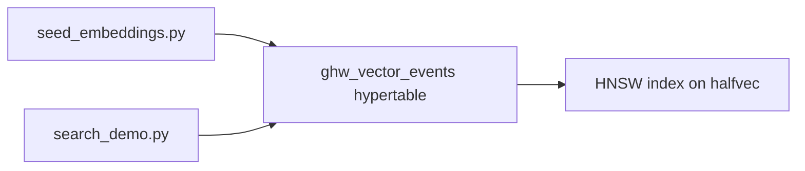

# tiger-pgvector

Hybrid **time-series + vector** search on [Tiger Cloud](https://www.tigerdata.com/) for MLH [Implement AI-Powered Vector Search with pgvector](https://www.mlh.com/events/global-hack-week-open-source-90/challenges/01a11b66-3a25-902e-3690-f9ea40cd5014/submissions/new).

Embeddings live in hypertable `ghw_vector_events` on the existing **`stillbench`** service (same pattern as [tiger-hypertable](https://github.com/smriad/tiger-hypertable), [tiger-iot](https://github.com/smriad/tiger-iot)). You query by **cosine distance**, **time range**, and **metadata** (`location`, `event_type`, `sensor_id`) in one SQL statement—no separate vector DB.

## Architecture



## Prerequisites

- Tiger Cloud TimescaleDB (DEV), e.g. `stillbench`
- [Tiger CLI](https://www.tigerdata.com/docs/get-started/quickstart/mcp-cli) authenticated
- Python 3.10+

If `tiger db query` fails with password auth, refresh credentials:

```bash
tiger service update-password stillbench
tiger db save-password cygl9rx93h
```

## Setup

```bash
cd tiger-pgvector
python3 -m venv .venv
source .venv/bin/activate
pip install -r requirements.txt

tiger db query stillbench --file setup_pgvector.sql
python seed_embeddings.py
```

## Verify (screenshot for submission)

```bash
tiger db query stillbench --file verify_queries.sql
```

Or run a CLI search:

```bash
python search_demo.py "vibration on the pump" --location floor --hours 168
```

## Example hybrid query (time + metadata + vectors)

```sql
SET hnsw.ef_search = 100;
SET hnsw.iterative_scan = relaxed_order;

SELECT time, sensor_id, note,
       embedding <=> $1::halfvec(384) AS distance
FROM ghw_vector_events
WHERE location = 'floor'
  AND time >= now() - interval '7 days'
ORDER BY embedding <=> $1::halfvec(384)
LIMIT 5;
```

## MLH submission

- **Screenshot:** output of `verify_queries.sql` (extensions + hypertable + top similarity rows)
- **Link:** GitHub repo URL once pushed, or Tiger Cloud console link to `stillbench`
- **Sponsor usage:** pgvector + TimescaleDB hypertable on Tiger Cloud; HNSW index; filtered similarity search for hybrid RAG

## References

- [Key vector concepts for pgvector](https://www.tigerdata.com/docs/learn/search/key-vector-database-concepts-for-understanding-pgvector)
- [Understand pgvector and pgvectorscale](https://www.tigerdata.com/docs/learn/search/pgvector-pgvectorsearch)
- MLH guide: [Turning PostgreSQL Into a Vector Database](https://mlh.link/ghwHF1026-tigerdata-pgvector)
